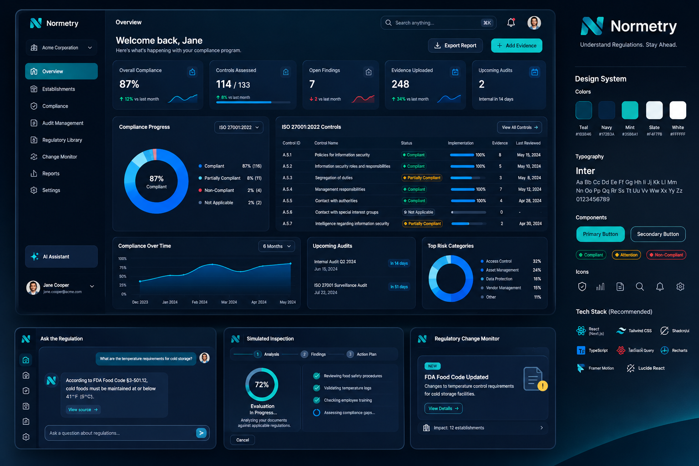
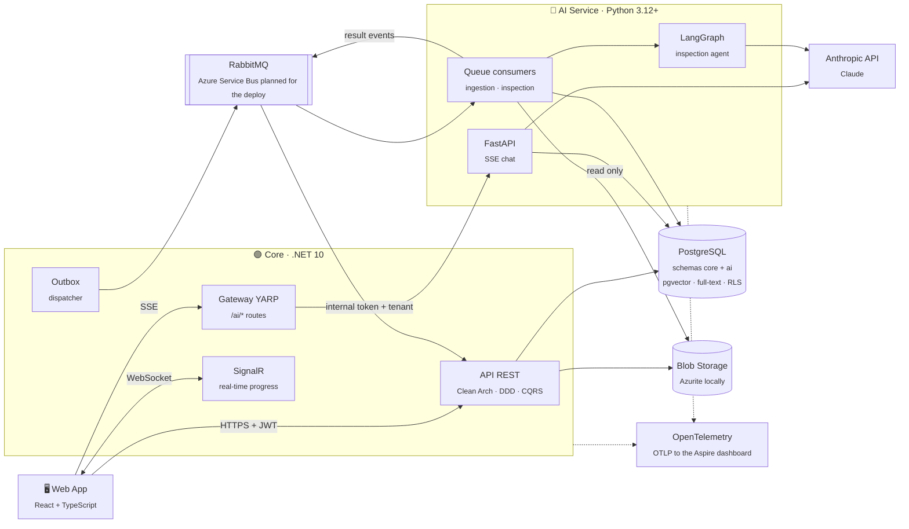
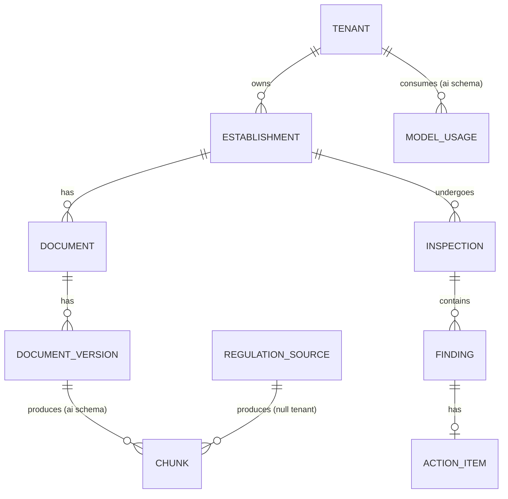
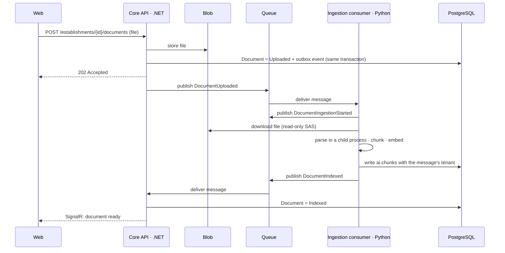
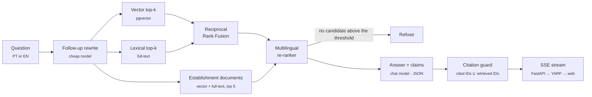
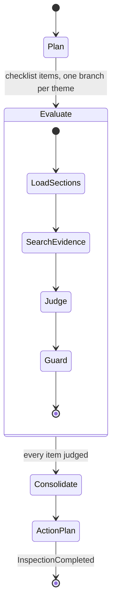

<p align="center">
  <picture>
    <source media="(prefers-color-scheme: light)" srcset="docs/design/brand/logo-horizontal-light.svg">
    
  </picture>
</p>

<p align="center">
  <i>Multi-tenant compliance copilot for regulated establishments.<br/>
  Ask the regulation and get an answer that cites the article, run a simulated inspection
  against your own documents, and (from phase 3) get warned when a rule you depend on changes.</i>
</p>

<p align="center">
  
  <a href="https://github.com/KauaVilasBoas/Normetry/actions/workflows/ci.yml">
    
  </a>
  <!-- TODO(fill later): latest release badge after v0.1.0 ships -->
  <!-- TODO(fill later): evals badge (retrieval recall@k / citation precision) once the eval suite runs in CI -->
  
  
  
  
  <a href="https://www.conventionalcommits.org/">
    
  </a>
  <a href="https://semver.org/">
    
  </a>
  <a href="LICENSE">
    
  </a>
</p>

<p align="center">
  <b>3</b> jurisdictions &nbsp;·&nbsp; <b>2</b> languages (PT, EN) &nbsp;·&nbsp; <b>131</b> checklist items &nbsp;·&nbsp; <b>2</b> of 3 AI capabilities built
</p>

<p align="center">
  <a href="#what-is-this">Why</a> &nbsp;·&nbsp;
  <a href="#capabilities">Capabilities</a> &nbsp;·&nbsp;
  <a href="#architecture-at-a-glance">Architecture</a> &nbsp;·&nbsp;
  <a href="#engineering-decisions">Decisions</a> &nbsp;·&nbsp;
  <a href="#evals">Evals</a> &nbsp;·&nbsp;
  <a href="#getting-started">Run it</a> &nbsp;·&nbsp;
  <a href="#roadmap">Roadmap</a> &nbsp;·&nbsp;
  <a href="#engineering-workflow">Workflow</a>
</p>

> [!NOTE]
> Normetry is being built in public, one phase at a time (see the [Roadmap](#roadmap)). Phases 0 to 2 are built, and the README marks what is still planned.

## What is this?

A restaurant manager has to comply with a food-safety code that runs to hundreds of pages. In practice, compliance lives in a binder: SOPs nobody re-reads, temperature logs filled in by hand, licenses that expire without warning. When an inspector arrives, someone has to say which rule each document satisfies and where the evidence is, and nobody can do that quickly.

Normetry answers that question. A customer (a single restaurant, a chain, or a compliance consultancy) registers its establishments and uploads its documents: SOPs, licenses, temperature logs, lab reports. Normetry reads them against the regulation. Every claim it makes points to a specific article and, when the claim is about the establishment, to a specific passage of the customer's own document.

The MVP covers food service in three jurisdictions:

| Jurisdiction | Regulation |
|---|---|
| United States | FDA Food Code |
| European Union | Regulation (EC) No 852/2004 on the hygiene of foodstuffs |
| Brazil | Anvisa RDC 216/2004, good practices for food services |

Users can ask in Portuguese or English, and answers quote the regulation in its original language. A question asked in Portuguese can come back with a cited passage of the FDA Food Code in English.

The data model already supports other establishment types such as pharmacies and clinics, so adding a vertical means adding its corpus, its inspection checklist and its eval set.

### Highlights

- Every claim cites a retrieved chunk with a literal quote. The model answers in structured JSON: each claim carries the IDs of the chunks that support it and, for each one, a passage copied from that chunk. A deterministic guard drops any claim whose ID was not retrieved or whose quote is not in its chunk. Only checked claims reach the user, streamed one at a time; if none survives, the answer is "not enough basis in the regulation".
- Retrieval is written by hand: pgvector top-k and PostgreSQL full-text top-k, fused with Reciprocal Rank Fusion, then a multilingual re-ranker. Each step can be inspected and measured on its own.
- The chat can also cite the selected establishment's own documents, for users who hold `documents.read`. The core tells the AI service whether the caller holds it. Without it, retrieval searches the regulation alone, and stored claims that cite a document are left out of the conversation. The regulation stays the only source of rules, and a document is evidence about the establishment.
- The simulated inspection checks a curated checklist per regulation: 47 items for the FDA Food Code, 40 for 852/2004 and 44 for RDC 216/2004 ([ADR 013](docs/adr/013-inspection-checks-a-curated-checklist.md)). A fixed list gives precision and recall a fixed denominator, and a run costs one judge call per item. The judge's quotes go through the same kind of guard: a finding with no verified regulation quote is dropped, and a compliant or non-compliant verdict with no verified quote from the customer's documents becomes insufficient evidence. Severity comes from the checklist, never from the model.
- The inspection is a LangGraph graph whose checkpoints live in two `ai` tables under forced RLS. The project writes its own small saver (`TenantCheckpointSaver`) that runs every read and write inside the tenant transaction; `langgraph-checkpoint-postgres` needs autocommit connections, so it is not used. If the AI service dies mid-inspection, the queue redelivers the request and the run resumes without judging finished items again.
- Findings are reviewed in the core. They arrive as a queue event and start as pending. A person accepts them, rejects them with a reason, or edits them, and the original values are kept. In development, rejected and edited findings can be exported as eval examples.
- PostgreSQL Row-Level Security isolates tenants on every tenant-owned table, so even a buggy query cannot return another tenant's rows. The tenant is set per transaction, which keeps pooled connections from carrying it into the next request. A session with no tenant set sees only the public corpus and cannot write.
- Only a dedicated `corpus_ingestor` role can write the public regulation corpus (`tenant_id IS NULL`), so no tenant can inject text into the shared regulations.
- Uploads are parsed in a child process whose environment holds no credentials, with a timeout and, outside Windows, a memory limit. On Linux the service process is marked non-dumpable, so the child cannot read the service's environment; running the child as its own OS user with no network is deploy work for phase 3. The AI service reads files with a read-only SAS for the documents container, and only the API holds the storage key.
- Every authenticated request draws from a rate limit per tenant and user, with stricter limits on uploads, inspection starts and chat. Daily quotas by plan cap chat messages and inspections, each inspection has a token ceiling, and a tenant can have at most two inspections in flight.
- Logs carry ids, codes and counts, never document text. Tests in both services run a document with a marker name through upload, ingestion, chat and inspection, and fail if the name shows up in any log line, span or trace tag.
- Pull requests that touch ingestion, retrieval, the models, the datasets or the synthetic establishments run the retrieval eval in CI, on local models and a throwaway PostgreSQL. It fails below its recall and MRR floors or when a result holds another establishment's chunk, and writes its table to the job summary. The generation and inspection evals call a paid model, so they run on demand, never in CI, and a review session judges their output against its quotes.
- OpenTelemetry runs in both services and propagates W3C `traceparent` over HTTP and through the message queue, so one trace follows a request from the core API through the queue into the AI service and back. Locally the traces go to the Aspire dashboard. The tokens and cost of every model call are recorded per tenant in `ai.model_usage`. Langfuse comes in phase 3.

## Capabilities

| Capability | What it does | Core technique | Status |
|---|---|---|---|
| Ask the regulation | Answers regulatory questions in a chat and cites the exact article, plus the passage of the establishment's own document when the question is about it | Hybrid RAG with verifiable citations | Working (phase 1; documents in phase 2) |
| Simulated inspection | Checks the establishment's documents against the regulation's checklist and produces findings, each with its quotes, and an action plan that a person reviews | LangGraph agent with checkpoints under RLS, one judge call per item, human review in the core | Working (phase 2); first eval run pending ([#106](https://github.com/KauaVilasBoas/Normetry/issues/106)) |
| Change monitor | Detects when a regulation changes and warns the tenants whose documents are affected | Structural diff plus semantic search over tenant documents | Planned (phase 3) |

The web app has five screens: Overview (compliance from the latest inspection, results by theme, open actions, expiring documents), Ask the Regulation, Documents (upload, versions, live status, expiry dates), Simulated Inspection and Settings › Profiles.

<!-- TODO(fill later): screenshots / GIF of the three capabilities
## Screenshots


| Simulated inspection | Change monitor |
|---|---|
|  |  |

<sub>Captured from the public demo with fictional establishments and no real customer data.</sub>
-->

<!-- TODO(fill later): live demo link + demo video (in English)
**Live demo:** https://...  ·  **Demo video:** https://...
-->

### Design

The web app follows an approved mock: dark navy surfaces, one mint accent for actions, the Inter typeface, and a single card style for KPIs, tables, chat and inspection progress. [`docs/design/DESIGN.md`](docs/design/DESIGN.md) turns the mock into color tokens, component specs and a screen-by-screen mapping, and each built screen has its own spec next to it. The mock's sample content (ISO 27001 controls, a fictional company) is placeholder.



## Architecture at a glance

The system has two services with a hard ownership boundary: .NET owns the business logic and Python owns the AI. The .NET core is the only entry point from outside, and the Python service has no public ingress.



Only .NET writes the `core` schema and only Python writes the `ai` schema. AI results such as findings and document status reach the core as queue events.

### Bounded contexts (core)

| Context | Responsibility |
|---|---|
| Tenancy & Identity | Tenant, User, and profiles that grant permissions (system profiles Owner, Manager, Auditor, plus the tenant's own; ADR 012). OIDC through Keycloak in local development |
| Establishments | Establishment with its type (restaurant, pharmacy, clinic) and jurisdiction |
| Documents | Document, versions, type (SOP, license, log, report, other), an optional expiry date the user types, and status `Uploaded → Processing → Indexed \| Failed` |
| Inspections (assessments) | Simulated inspections (`Requested → Running → Completed \| Failed`), their findings with copies of what they cite, one action item per finding, and the review (Accepted, Rejected, Edited). The Overview screen reads from it and from Documents |
| Usage | Daily chat messages per user and daily inspections per tenant, counted in PostgreSQL by plan (ADR 010), and the token ceiling sent with each inspection. The AI service records the tokens and cost of every model call |
| Notifications | Planned for phase 3: change-monitor alerts and expiring-document warnings |

The regulation catalog is not a core context: the AI service owns the corpus, and the core only names each jurisdiction's regulation.

<details>
<summary>Data model</summary>



Regulations and tenant documents share the central table, `ai.chunks`. A null `tenant_id` marks the public corpus, and RLS policies protect the rest. A finding keeps copies of the passages it quotes, as chat answers do, so a new document version never breaks an old inspection.

```sql
-- read: public corpus + the caller's own tenant
CREATE POLICY chunks_read ON ai.chunks FOR SELECT TO app_ai
  USING (tenant_id IS NULL
         OR tenant_id = (SELECT NULLIF(current_setting('app.tenant_id', true), '')::uuid));

-- public corpus: only the regulation-ingestion role can write it
CREATE POLICY chunks_corpus_write ON ai.chunks FOR ALL TO corpus_ingestor
  USING (tenant_id IS NULL) WITH CHECK (tenant_id IS NULL);
```

</details>

<details>
<summary>Document ingestion flow</summary>

Long-running work is asynchronous. The outbox keeps an event from being lost between the database commit and the queue.



1. Upload: PDF, DOCX, TXT or CSV, checked by extension, content type and first bytes, at most 10 MiB.
2. Parse, in a child process with no credentials, a 60-second timeout and, outside Windows, a 512 MB memory limit. PDFium reads a PDF's text layer, one section per page. python-docx reads DOCX paragraphs and tables, and the headings build the section path. TXT is read as UTF-8, else Latin-1. CSV rows are grouped with the header row repeated in each group. There is no OCR: a scan with no text layer fails with `no_text_layer`. The regulations use the same PDFium parser, plus an HTML parser for the Anvisa page.
3. Structural chunking: regulations are split by article or section, and the hierarchy is kept in `section_path` (for example `Chapter 3 > 3-501.16`). Tenant documents are cut inside the sections the parser produced.
4. Metadata, with no model call: the language is detected from function words, the title and type come from the upload form, and the expiry date is a field the user fills in (optional, for licenses and certificates).
5. Indexing: each chunk gets an embedding and a `tsvector` built with its language's configuration (`portuguese` or `english`).
6. Idempotency: a content hash identifies each chunk, and a new document version replaces the previous chunks in the same transaction.

</details>

<details>
<summary>Retrieval and generation (chat)</summary>



- Tenant, establishment and jurisdiction reach the AI service in internal headers that the .NET core derives from the validated JWT, along with whether the caller holds `documents.read`. The request body never sets them.
- With `documents.read`, the chat also searches the selected establishment's documents: up to 5 chunks of their current indexed versions, scored in the same re-ranker call as the regulation candidates. The top 10 keeps at most 3 document chunks, and a tie goes to the regulation. Without the permission, retrieval covers the corpus only.
- The prompt marks each excerpt as regulation or document. The regulation is the only source of rules; a document describes the establishment, and instructions inside it are never followed. A document citation names the document, its type and its version.
- The refusal threshold applies to the best score of either source. It is 0 by default, so only an empty retrieval is refused before the model call: in the phase 1 eval the best scores of answerable questions and of refusals overlapped, so the guard does the refusing.
- A cheap model (Claude Haiku 5.5 by default) rewrites follow-up questions into standalone ones. The chat model (Claude Opus 5.5 by default, a setting) writes the answer.

</details>

<details>
<summary>Simulated inspection agent</summary>



- Start: a user with `inspections.run` (Owner and Manager by default) starts an inspection of one establishment. The core refuses it while another one is running there, when no document is indexed, past the tenant's daily quota, or when the tenant already has two inspections in flight. Otherwise it commits the inspection and `InspectionRequested` through the outbox.
- Plan, with no model: the checklist items for the jurisdiction and establishment type, grouped into eight themes (personal hygiene, temperature control, cross-contamination and allergens, cleaning and sanitizing, pest control, water and premises, waste, documentation and training).
- Evaluate: one branch per theme through LangGraph's `Send`, each item a task, with at most four items in flight per inspection. For each item the agent loads the regulation sections it cites, searches the establishment's documents with the item's title and evidence hint (vector and full-text, fused, re-ranked, top 5), then makes one structured-output call to the judge (Claude Haiku 5.5 by default). The judge has no tools, and document text enters the prompt as escaped excerpts marked as data.
- Guard: every quote is checked against its excerpt. A finding with no verified regulation quote is dropped, and a compliant or non-compliant verdict with no verified document quote becomes insufficient evidence. A requirement that no document shows is therefore never reported as a violation.
- Consolidate and action plan: one result per item, sorted by severity. Each non-compliant or insufficient-evidence finding gets one action, due in 7, 30 or 90 days for a critical, major or minor item. The judge proposes the action text (a fixed template when it gives none or its verdict was downgraded), and the severity sets the deadline.
- Checkpoints: `TenantCheckpointSaver` stores each step before the next starts. The request stays unacknowledged while the inspection runs, so if the process dies RabbitMQ redelivers it and the run resumes from the last checkpoint. A request whose checkpoints belong to another establishment is dead-lettered.
- Budget: the core sends a token ceiling with each request (300,000 by default). Before every judge call the agent estimates the call, and when it would pass the ceiling the inspection fails with `budget_exceeded` and keeps no partial findings. Every call is recorded in `ai.model_usage`. A request still queued when the core has already timed it out (30 minutes by default) expires in the queue instead of running.
- Review in the core: progress reaches the web app over SignalR. The core stores the findings of `InspectionCompleted` only if every evidence citation names a document of the inspected establishment. Findings start as pending; with `inspections.review` a person accepts, rejects with a reason or edits them (verdict, severity, rationale, action, due date), and marks action items done.

</details>

<details>
<summary>Change monitor (planned for phase 3)</summary>

None of this is built yet. The plan:

- A scheduled job compares each new version of a regulation with the previous one, article by article, using `section_path` and a content hash.
- The changed articles are searched semantically across the documents of tenants in the same jurisdiction.
- Each affected tenant gets a notification that shows what changed and which passage of its SOP the change touches.
- The demo ingests a v1 and a v2 with controlled changes so the result is reproducible.

</details>

## Engineering decisions

Full records are in [`docs/adr/`](docs/adr/).

| ADR | Decision | Why | Trade-off |
|---|---|---|---|
| [001](docs/adr/001-core-in-dotnet-ai-in-python.md) | Core in .NET, AI in Python | .NET fits B2B domain modeling well; the RAG and eval ecosystem is more mature in Python | Two runtimes and toolchains, and a network boundary between the services |
| [002](docs/adr/002-one-postgresql-with-core-and-ai-schemas.md) | One PostgreSQL with a `core` schema (EF Core) and an `ai` schema (Alembic) | pgvector and full-text search live next to the business data, with no external vector DB to sync | At millions of chunks, Qdrant or Azure AI Search may be needed |
| [003](docs/adr/003-tenant-isolation-with-rls.md) | Tenant isolation with Row-Level Security | A query bug still cannot return another tenant's rows | The tenant must be set per transaction to stay safe with connection pooling |
| [004](docs/adr/004-dotnet-single-entry-point-with-yarp.md) | .NET as the single entry point, with YARP in front of Python | Auth, rate limiting and the token budget live in one place, and Python is never exposed | One extra network hop on chat |
| [005](docs/adr/005-outbox-for-long-running-work-sse-for-chat.md) | Outbox for long-running work, SSE for chat | Ingestion and inspection can take minutes, and the outbox keeps every event | The UI is eventually consistent, and every consumer must be idempotent |
| [006](docs/adr/006-hand-written-retrieval-langgraph-for-agents.md) | Retrieval written by hand, LangGraph only for agents | Each step can be measured by the evals and explained | More code to own |
| [007](docs/adr/007-verifiable-citations.md) | Verifiable citations | Structured claims, each with a literal quote that a guard finds in a retrieved chunk before the claim is shown | One extra validation step, some answers become refusals, and a misquoted claim is dropped |
| [008](docs/adr/008-embedding-model-chosen-by-evals.md) | Embedding model behind an interface, chosen by eval | Changing models becomes an experiment with a measured result | The vector dimension is tied to the model, so a switch means re-embedding the corpus |
| [009](docs/adr/009-in-house-cqrs-dispatcher.md) | In-house CQRS dispatcher instead of MediatR | MediatR has required a commercial license since 2025, and a small dispatcher shows how the pattern works | We own and test the pipeline, and there are no ecosystem extensions |
| [010](docs/adr/010-daily-chat-quota-by-plan.md) | Daily chat quota per user by plan, counted in PostgreSQL | Model calls cost money, and the limit must survive restarts and hold across API instances | One database write per chat message, and old count rows need a cleanup job |
| [011](docs/adr/011-web-app-is-a-vite-spa.md) | The web app is a Vite single-page app with in-memory tokens, calling only the core API | All data and rules already sit behind the .NET API, so a second server would have nothing to do; no token is kept in web storage | No server rendering, and a reload goes back through Keycloak |
| [012](docs/adr/012-authorization-by-permissions-in-the-core-database.md) | Authorization by permissions in the core database: tenant profiles grant `area.action` permissions, checked with `[HasPermission]` (one attribute naming several accepts any of them); Keycloak only authenticates | Tenants manage their own profiles, changes apply on the next request, and RLS isolates the data | One query per protected request, and authorization depends on the core database |
| [013](docs/adr/013-inspection-checks-a-curated-checklist.md) | The simulated inspection checks a curated checklist per regulation (40 to 47 reviewed items, each tied to its sections) | One judge call per item keeps an inspection to cents and minutes, and a fixed list makes precision and recall measurable | Requirements outside the checklist are never reported, and the lists need upkeep when a regulation changes |

<details>
<summary>Why PostgreSQL and not SQL Server?</summary>

SQL Server 2025 has a vector type and would work. PostgreSQL has the larger ecosystem for this workload: pgvector is the default in Python AI tooling, HNSW indexes and full-text search run in the same engine, and Azure offers it as a managed service (Flexible Server).

</details>

## Security

- Indirect prompt injection: document text enters prompts as escaped excerpts marked as data, and the prompts say that instructions inside a document are never followed. Neither the chat nor the judge has tools, and inspection results reach the core as an event and stay pending until a person reviews them. Each synthetic establishment carries one planted injection document; the evals that score it have not had their first paid run yet ([#106](https://github.com/KauaVilasBoas/Normetry/issues/106), [#109](https://github.com/KauaVilasBoas/Normetry/issues/109)).
- Tenant isolation: RLS on every tenant-owned table in both schemas, the inspection checkpoints included, with isolation tests for each one. The establishment document search joins on the establishment, and its tests cover another tenant, another establishment of the same tenant, a deleted document and a superseded version. The core refuses an inspection result whose evidence cites a document outside the inspected establishment. In the retrieval eval, no result held a chunk from another establishment or tenant.
- Document access: the chat shows document text only to callers with `documents.read`. The gateway sets that header from the caller's loaded permissions and strips any copy the client sends.
- Network edge: the Python service has no public ingress, and FastAPI accepts only requests that YARP sends with an internal token.
- Abuse and cost: ASP.NET Core rate limiting per tenant and user (by default 120 requests a minute, 20 uploads, 5 inspection starts and 20 chat requests), daily quotas by plan for chat messages and inspections, a token ceiling per inspection and at most two inspections in flight per tenant.
- Uploads: file type, content and size are validated, and parsing runs in a child process with no credentials, limits on time and memory, and a non-dumpable parent on Linux. Running the child as a separate OS user with no network is deploy work for phase 3. The AI service's blob credential can only read the documents container.
- Logs: both services log ids, codes and counts, never document text, quotes, prompts or answers, and a test in each service checks it with a marker name. The AI service refuses to start with LangSmith tracing on, so no graph state leaves for an outside service. There are no LLM traces yet; masking names in them comes with Langfuse in phase 3.
- Secrets: none are stored in this repository. Local development uses git-ignored `.env` files and `dotnet user-secrets`, and CI and deploy read GitHub Actions secrets.

## Evals

Five layers of evals measure quality:

| Layer | Metric | How it's measured |
|---|---|---|
| Retrieval | recall@k, MRR, document recall, chunks from another establishment | 59 regulation questions with 83 literal quotes ([regulation-qa](evals/datasets/regulation-qa/)) and 32 questions asked from the synthetic establishments ([document-qa](evals/datasets/document-qa/)); a hit is a retrieved chunk that contains a quote. Runs in CI on pull requests that touch retrieval ([`evals/README.md`](evals/README.md)) |
| Generation | faithfulness, citation correctness, refusals, cost per answer, time to first claim | The real pipeline answers the golden dataset with a chosen Claude model, on demand and never in CI. The guard checks every quote at runtime, and each claim is then judged against its quotes in review sessions. The document questions are scored too; their first run is pending ([#109](https://github.com/KauaVilasBoas/Normetry/issues/109)) |
| Inspection | finding precision and recall per verdict, guard drops, injection success, near misses accepted, cross-establishment evidence, cost and time | 3 [synthetic establishments](evals/establishments/) with 31 documents, 23 planted non-conformities, one injection document and one near miss (a document that looks like evidence but does not cover the item) each, scored against their expected findings for all 131 checklist items. Harness built; first run pending ([#106](https://github.com/KauaVilasBoas/Normetry/issues/106)) |
| Security | cross-tenant and cross-establishment leaks, successful injections | The 14-item security set of document-qa: 4 cross-tenant, 4 cross-establishment and 6 planted-instruction items. Scored by the retrieval eval (no leaked chunk so far) and by the generation eval, whose run is pending ([#109](https://github.com/KauaVilasBoas/Normetry/issues/109)) |
| Operations | cost per answer and per inspection, latency | The generation eval reports cost and time per answer, and the inspection eval's report has them per inspection (first run pending). Every model call is recorded in `ai.model_usage`. Langfuse dashboards come in phase 3 |

Planned experiments: BGE-M3 against a second local embedding model (ADR 008), and Claude Haiku, Sonnet and Opus on the final prompt before the demo is deployed ([#73](https://github.com/KauaVilasBoas/Normetry/issues/73)).

Retrieval numbers, on the 44 answerable questions ([report](evals/reports/2026-11-14-retrieval-bge-m3-reranked.md)):

| Retrieval step (BGE-M3) | recall@10 | MRR@10 |
|---|---|---|
| Vector search only | 0.943 | 0.842 |
| Full-text search only | 0.714 | 0.524 |
| Both, merged with Reciprocal Rank Fusion | 0.864 | 0.711 |
| Fusion, then the bge-reranker-v2-m3 re-ranker | 0.934 | 0.883 |

No chunk came back from another jurisdiction. On CPU the re-ranker takes 15.4 s per question on average (30 candidates, up to 1024 tokens each), against under 0.2 s for embedding and both searches; halving candidates and length cut it to 9.3 s but dropped recall@10 to 0.900 and the Portuguese 852/2004 items to 0.714.

With documents ([#109](https://github.com/KauaVilasBoas/Normetry/issues/109), [report](evals/reports/2026-11-18-retrieval-bge-m3-with-documents.md)), the retrieval eval indexes the 28 synthetic documents in the demo's two tenants and asks each question from an establishment, as the chat does:

| Retrieval with the establishments' documents (BGE-M3, re-ranked) | recall@10 | MRR@10 |
|---|---|---|
| Document questions, document quotes | 0.828 | |
| Regulation questions, from an establishment with no documents | 0.934 | 0.883 |
| Regulation questions, from an establishment with its documents | 0.934 | 0.613 |

The documents leave regulation recall@10 where it was but push regulation chunks down the top 10, so MRR@10 falls from 0.883 to 0.613. No result held a chunk from another establishment or tenant.

Two later changes left the re-ranked numbers above unchanged. Splitting the FDA Food Code's three-digit subsections into sections of their own ([#114](https://github.com/KauaVilasBoas/Normetry/issues/114), [report](evals/reports/2026-11-20-retrieval-bge-m3-fda-subsections.md)) took the corpus from 724 to 750 chunks; only the fused list moved, recall@10 from 0.864 to 0.847, mostly on FDA items, and the re-ranker recovers it. The three near-miss documents ([#116](https://github.com/KauaVilasBoas/Normetry/issues/116)) changed nothing.

Generation numbers come from Claude Haiku 5.5 answering all 59 questions through the real pipeline ([report](evals/reports/2026-11-15-generation-claude-haiku-5-5.md)). The guard checks every quote at runtime. A review session then judged each claim against its quotes and the section around them:

| Generation (Claude Haiku 5.5) | Result | Target |
|---|---|---|
| Claims whose quotes state them in full | 87 of 109 (80%); 21 partial, 1 unsupported | no unsupported claim |
| Answerable questions answered completely | 38 of 44; 4 partial, 1 wrong, 1 refused | |
| Not-covered questions refused | 9 of 9 | ≥ 90% |
| Expected refusals refused, all types | 14 of 15 | |
| Citations outside the establishment's jurisdiction | 0 | 0 |
| Cost per answer | US$ 0.0009 | |
| Time to first claim, p95 | 27.7 s (retrieval about 15 s, the model about 4 s) | < 6 s |

A partial claim restates its own section but stops one step short: the quote ends before a condition the claim states, or a rule written for a category of food is applied to the dish the question names. The first run ([report](evals/reports/2026-11-15-generation-claude-haiku-5-5-first-prompt.md)) also showed the model writing claims about what the excerpts leave out, and the follow-up rewrite once returned its own scratch work. Both were fixed: the prompt now forbids those claims and makes quotes carry their conditions, and the rewrite now goes through structured output. The second run confirmed the rewrite fix. The prompt fix added one correct refusal, but its effect on faithfulness was within the run-to-run variation of the model. The p95 target fails on the CPU re-ranker, not on the model ([#72](https://github.com/KauaVilasBoas/Normetry/issues/72)).

The paid evals of phase 2 have not run yet. The inspection eval ([#106](https://github.com/KauaVilasBoas/Normetry/issues/106)), the generation eval over the document questions and the security set ([#109](https://github.com/KauaVilasBoas/Normetry/issues/109)), and the review of real judge calls on the synthetic documents ([#100](https://github.com/KauaVilasBoas/Normetry/issues/100)) have their harnesses and offline scoring tests in place, and their numbers go here after the first run with an Anthropic API key.

<!-- TODO(fill later): the BGE-M3 vs Qwen3-Embedding-0.6B row once measured -->

## Stack

<p>
  
  
  
  
  
  
  
  
  
  
  
  
  
  
  
  
  
  
  
  
  
</p>

## Getting started

Prerequisites: .NET 10 SDK, [uv](https://docs.astral.sh/uv/) (it installs Python 3.12+), Node.js 22.22+ with npm, Docker.

```bash
git clone https://github.com/KauaVilasBoas/Normetry.git
cd Normetry
dotnet dev-certs https --trust                    # once, so services can send telemetry to the dashboard
dotnet run --project src/core/Normetry.AppHost    # PostgreSQL, RabbitMQ, Azurite, Keycloak, migrations, API, AI service and web app
```

The first run generates every password and the internal token and keeps them in the AppHost's user secrets, so there is nothing to configure. The console prints the Aspire dashboard login link (`https://localhost:17081`). If Docker cannot reach `mcr.microsoft.com`, set `ASPIRE_ENABLE_CONTAINER_TUNNEL=false` first.

The chat and the inspection also need the regulation corpus and an Anthropic API key. Fetch the corpus with `uv run corpus/scripts/fetch_corpus.py` from the repository root, then start the `corpus-ingest` resource once from the dashboard (the first run also downloads the embedding model, about 2.3 GB). The key is the only secret the AppHost does not generate: `dotnet user-secrets set Parameters:anthropic-api-key <key> --project src/core/Normetry.AppHost`. Without it everything still starts, but chat answers come back unavailable and inspections fail.

The local Keycloak realm has two demo tenants and four demo users ([`deploy/keycloak/README.md`](deploy/keycloak/README.md)). In Development the core gives each user its profile and uploads the synthetic documents of [`evals/establishments/`](evals/establishments/) to the three demo establishments, through the real pipeline. Open the web app at `http://localhost:5173` and sign in as `bistro.owner` with the password `local-demo-only`. To call the API directly on `http://localhost:5208`:

```bash
TOKEN=$(curl -s http://localhost:8180/realms/normetry/protocol/openid-connect/token \
  -d grant_type=password -d client_id=normetry-dev \
  -d username=bistro.owner -d password=local-demo-only | jq -r .access_token)

curl -H "Authorization: Bearer $TOKEN" http://localhost:5208/me          # user, tenant, profiles, permissions
curl -H "Authorization: Bearer $TOKEN" -H 'Content-Type: application/json' \
  -d '{"name":"Bistro Centro","type":"Restaurant","jurisdiction":"BR"}' \
  http://localhost:5208/establishments                                     # 201
curl -H "Authorization: Bearer $TOKEN" http://localhost:5208/ai/health   # AI service, through the gateway
```

With a `bakery.auditor` token the Bistro's establishment does not show up: RLS hides it.

### Tests

`dotnet test` from the repository root, `uv run pytest` from `src/ai` and `npm test` from `src/web`. Database tests need Docker; without it they are skipped locally and fail in CI.

- Domain: unit tests.
- Integration: Testcontainers with a real PostgreSQL and RabbitMQ, RLS included. Tenant A must never read tenant B's rows, in either schema.
- Architecture: NetArchTest rules fail the build when a layer depends on one it should not.
- Logs: a test in each service fails when a document's marker name reaches a log line or a trace.
- Evals: the retrieval eval runs on every pull request that touches ingestion, retrieval, the models, the datasets or the synthetic establishments. The paid evals run on demand ([`evals/README.md`](evals/README.md)).

## Project structure

```
normetry/
├── src/
│   ├── core/                      # .NET 10
│   │   ├── Normetry.BuildingBlocks/  # CQRS dispatcher, Result types
│   │   ├── Normetry.Domain/
│   │   ├── Normetry.Application/
│   │   ├── Normetry.Infrastructure/  # EF Core, outbox, RabbitMQ, blob storage
│   │   ├── Normetry.Migrations/   # EF Core: Schema/ and Data/, run as core_owner
│   │   ├── Normetry.Api/          # endpoints, auth, rate limiting, SignalR hubs, YARP gateway to /ai/*
│   │   ├── Normetry.ServiceDefaults/  # Aspire: telemetry, health checks
│   │   ├── Normetry.AppHost/      # Aspire
│   │   └── tests/                 # unit, integration, architecture
│   ├── ai/                        # Python
│   │   ├── normetry_ai/
│   │   │   ├── api/               # FastAPI: chat (SSE)
│   │   │   ├── ingestion/         # corpus and upload parsers, parsing sandbox, chunking
│   │   │   ├── retrieval/         # hybrid search, establishment documents
│   │   │   ├── answers/           # cited answers and the citation guard
│   │   │   ├── conversations/
│   │   │   ├── inspection/        # checklists, judge, LangGraph graph, checkpoint saver
│   │   │   ├── messaging/         # queue contracts and consumers
│   │   │   ├── llm/               # Claude calls, embeddings, re-ranker, usage
│   │   │   └── evals/             # dataset checks and eval scoring
│   │   ├── migrations/            # Alembic: schema/ and data/
│   │   └── tests/
│   ├── shared/contracts/          # HTTP and queue contracts both backends implement
│   └── web/                       # React + TypeScript
├── evals/
│   ├── datasets/                  # regulation-qa, document-qa, inspection-feedback
│   ├── establishments/            # synthetic establishments: documents and expected findings
│   └── reports/
├── corpus/                        # versioned regulations + download scripts
├── docs/
│   ├── adr/
│   └── design/                    # approved UI mock, design system, screen specs
├── deploy/
│   ├── postgres/                  # roles, schemas, bootstrap
│   └── keycloak/                  # local realm and login theme
└── .github/workflows/
```

Planned for the phase 3 deploy: `deploy/docker-compose.yml` and `deploy/terraform/`.

## Roadmap

| Phase | Delivery | Status |
|---|---|---|
| 0 · Foundation | Monorepo, Aspire, auth, tenants and establishments, PostgreSQL with RLS and isolation tests, CI | Done |
| 1 · Regulation RAG | Ingestion of the 3 regulations, hybrid search with re-ranker, cited chat with conversations and daily quotas, retrieval eval in CI, generation eval on demand | Done |
| 2 · Simulated inspection | Permissions by profile, async upload and ingestion with versions and expiry dates, synthetic establishments, the LangGraph inspection agent, human review and action plan, chat over the establishment's documents, rate limiting, sandboxed parsing, Overview screen | Done; the first paid eval runs are pending ([#106](https://github.com/KauaVilasBoas/Normetry/issues/106), [#109](https://github.com/KauaVilasBoas/Normetry/issues/109), [#100](https://github.com/KauaVilasBoas/Normetry/issues/100)) |
| 3 · Polish | Change monitor, MCP server, Langfuse, chat model comparison, re-ranker latency, Azure deploy, demo video | Next |

Phase 3 also adds an MCP server: the .NET core exposes read-only tools (establishments, expiring documents, latest findings) through the official C# MCP SDK, so Claude Desktop can connect straight to the product. A second retrieval adapter, Azure AI Search behind the same interface, will be compared against pgvector by the evals.

The MVP leaves out billing, corporate SSO and a mobile app.

<!-- TODO(fill later): "What I learned" + "What I'd do differently" sections after phase 1 ships -->

## Engineering workflow

- Each feature starts as a GitHub issue, gets its own branch and lands through a pull request that closes the issue. Merged branches are deleted.
- Commits follow [Conventional Commits](https://www.conventionalcommits.org/), one logical change per commit.
- Versions follow [SemVer](https://semver.org/). [release-please](https://github.com/googleapis/release-please) reads the commit history and keeps a release PR open; merging it creates the tag, the GitHub Release and the `CHANGELOG.md` entry. The project stays on 0.x until the MVP is published.
- Architecture decisions are recorded as ADRs in [`docs/adr/`](docs/adr/).
- Development uses Claude Code with a harness committed in this repository: [`CLAUDE.md`](CLAUDE.md) files per service, specialist subagents (.NET core, AI service, web, UX/UI review, tenant-isolation review, eval runner), project skills for RLS tables, CQRS slices, ADRs and the design system, and hooks that block secret-looking content, secret-file reads and destructive commands.

## Author

Kauã Vilas Boas, backend engineer working in .NET and C#. I build .NET systems and libraries with documented architecture and CI/CD.

<p>
  <a href="https://www.linkedin.com/in/kauavilasboas/">
    
  </a>
  <a href="https://github.com/KauaVilasBoas">
    
  </a>
  <a href="mailto:kauavboas@gmail.com">
    
  </a>
</p>

Based in Brazil (UTC−3), with full overlap with US East Coast hours and European afternoons. Open to remote opportunities.

## License

[MIT](LICENSE)
