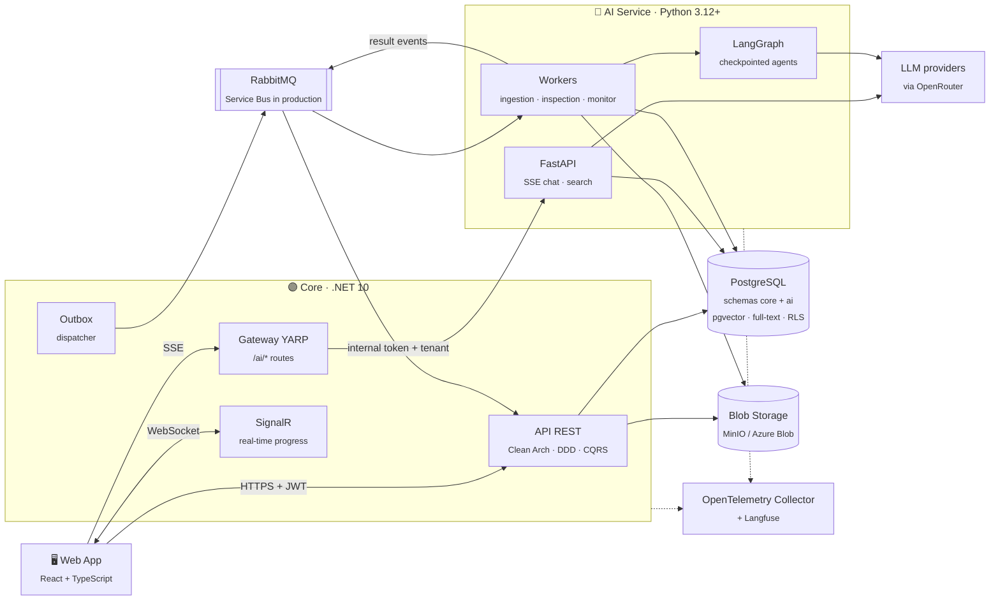
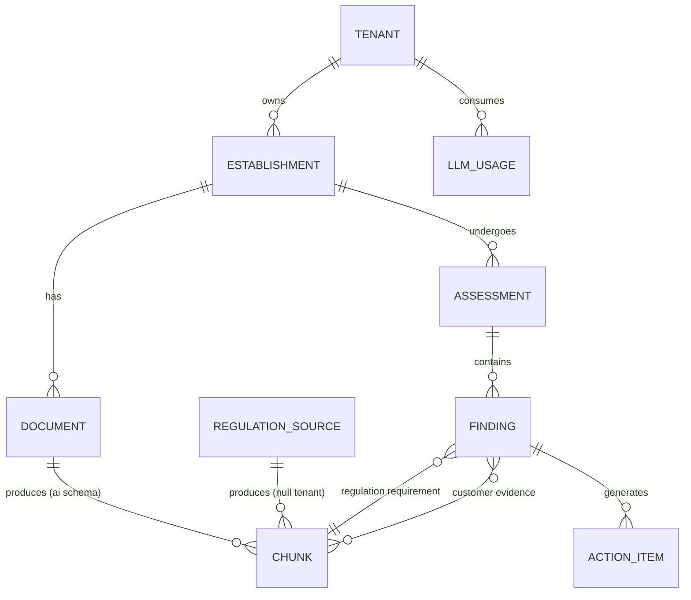
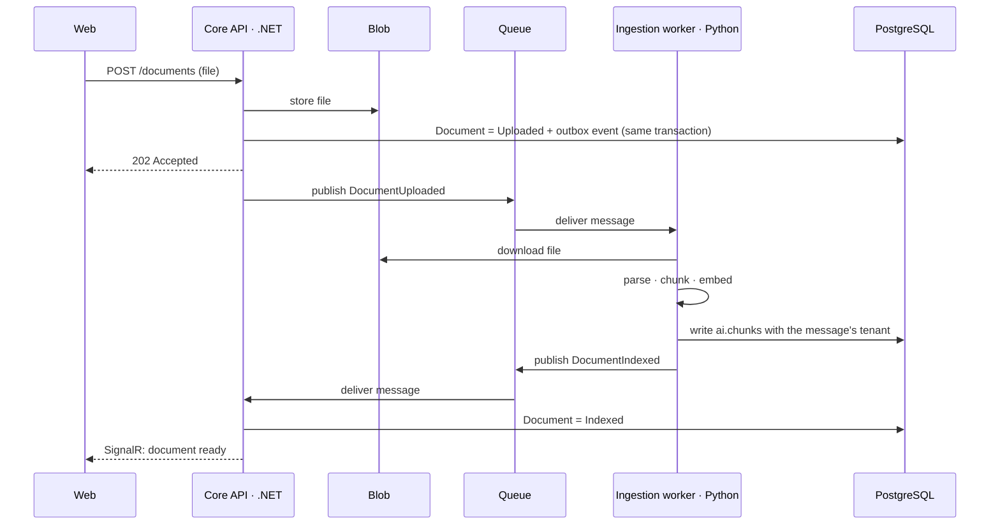
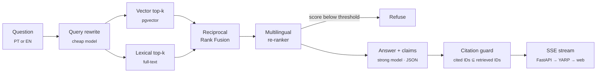
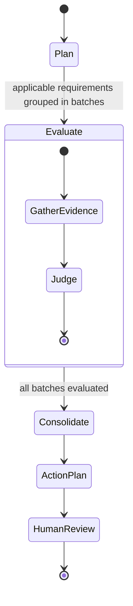

<!-- TODO(fill later): replace the text title with the logo once docs/brand/ exists -->
<h1 align="center">Normetry</h1>

<p align="center">
  <i>Multi-tenant <b>compliance copilot</b> for regulated establishments.<br/>
  Ask the regulation and get an answer that cites the article, run a simulated inspection
  against your own documents, and get warned when a rule you depend on changes.</i>
</p>

<p align="center">
  
  <!-- TODO(fill later): CI badge once .github/workflows/ci.yml exists
  <a href="https://github.com/KauaVilasBoas/Normetry/actions/workflows/ci.yml">
    
  </a>
  -->
  <!-- TODO(fill later): evals badge (retrieval recall@k / citation precision) once the eval suite runs in CI -->
  
  
  
  
  <a href="https://www.conventionalcommits.org/">
    
  </a>
  <a href="LICENSE">
    
  </a>
</p>

<p align="center">
  <b>3</b> jurisdictions &nbsp;·&nbsp; <b>2</b> languages (PT · EN) &nbsp;·&nbsp; <b>3</b> AI capabilities &nbsp;·&nbsp; <b>0</b> tolerated cross-tenant leaks
</p>

<p align="center">
  <a href="#what-is-this">Why</a> &nbsp;·&nbsp;
  <a href="#capabilities">Capabilities</a> &nbsp;·&nbsp;
  <a href="#architecture-at-a-glance">Architecture</a> &nbsp;·&nbsp;
  <a href="#engineering-decisions">Decisions</a> &nbsp;·&nbsp;
  <a href="#evals">Evals</a> &nbsp;·&nbsp;
  <a href="#getting-started">Run it</a> &nbsp;·&nbsp;
  <a href="#roadmap">Roadmap</a>
</p>

> [!NOTE]
> **Work in progress.** Normetry is being built in public, phase by phase (see the [Roadmap](#roadmap)).
> This README describes the target architecture; sections marked *coming soon* are filled in as each phase ships.

---

## What is this?

A restaurant manager has to comply with a food-safety code that runs to hundreds of pages. In
practice, compliance lives in a binder: SOPs nobody re-reads, temperature logs filled in by hand,
licenses that expire without warning. When the inspector arrives, the question is always the same:
*"which rule does this document satisfy, and where is the evidence?"* — and nobody can answer it
quickly.

**Normetry answers that question.** A customer (a single restaurant, a chain, or a compliance
consultancy) registers its establishments and uploads its documents: SOPs, licenses, temperature
logs, lab reports. Normetry then reads them **against the regulation itself**, and every claim it
makes points back to a specific article and a specific passage of the customer's own document.

The MVP targets **food service** across three jurisdictions:

| Jurisdiction | Regulation |
|---|---|
| 🇺🇸 United States | FDA Food Code |
| 🇪🇺 European Union | Regulation (EC) No 852/2004 on the hygiene of foodstuffs |
| 🇧🇷 Brazil | Anvisa RDC 216/2004 — good practices for food services |

Questions can be asked in **Portuguese or English**, and answers cite the regulation **in its
original language**: ask in Portuguese, get a cited passage of the FDA Food Code in English.

The data model already supports other establishment types (pharmacies, clinics), so new verticals
are a corpus and an eval set, not a rewrite.

### Highlights

- **Citations you can verify, not vibes** — the model answers in structured JSON where every claim
  carries the IDs of the chunks that support it. A deterministic guard drops any claim whose
  citation was not actually retrieved; if too little survives, the answer becomes *"not enough basis
  in the regulation"*. Below a re-ranker score threshold, the system refuses instead of guessing.
- **Hybrid retrieval, hand-written** — pgvector top-k + PostgreSQL full-text top-k, fused with
  Reciprocal Rank Fusion, then a multilingual re-ranker. No retrieval framework hiding the logic.
- **Tenant isolation enforced by the database** — PostgreSQL Row-Level Security on every
  tenant-owned table. Even a buggy query cannot return another tenant's data. The tenant is set
  per transaction, so pooled connections never leak it. Without a tenant, the policy sees only the
  public corpus and blocks writes: it **fails closed**.
- **A poisoned corpus is impossible by design** — the public regulation corpus (`tenant_id IS NULL`)
  can only be written by a dedicated `corpus_ingestor` role. No tenant can inject text into the
  shared regulations.
- **Agents with checkpoints and a human in the loop** — the simulated inspection is a LangGraph agent
  with Postgres checkpoints: if a worker dies mid-inspection, it resumes where it stopped. Findings
  are born *pending*; a human accepts, rejects or edits each one, and every rejection becomes a new
  eval example.
- **Evals are part of CI** — every PR touching prompts, retrieval or agents runs a reduced eval suite.
  The PR fails if a metric drops below its threshold, and the results table is posted as a comment.
- **One trace from click to LLM call** — OpenTelemetry in both services with W3C `traceparent`
  propagated over HTTP *and* through the message queue, plus Langfuse for prompts, tokens and cost.

---

## Capabilities

| Capability | What it does | Core technique |
|---|---|---|
| 💬 **Ask the regulation** | Chat that answers regulatory questions citing the exact article | Hybrid RAG + verifiable citations |
| 🔍 **Simulated inspection** | Evaluates the establishment's documents against applicable requirements; produces findings + an action plan | LangGraph agent with checkpoints and human review |
| 🔔 **Change monitor** | Detects when a regulation changes and warns the tenants whose documents are affected | Structural diff + semantic search over tenant documents |

<!-- TODO(fill later): screenshots / GIF of the three capabilities
## Screenshots


| Simulated inspection | Change monitor |
|---|---|
|  |  |

<sub>Captured from the public demo — fictional establishments, no real customer data.</sub>
-->

<!-- TODO(fill later): live demo link + showcase video (in English)
**Live demo:** https://...  ·  **Showcase video:** https://...
-->

---

## Architecture at a glance

Two services with a hard ownership boundary: **.NET owns the business**, **Python owns the AI**.
The .NET core is the only door to the outside world; the Python service is never exposed to the
internet.



**Ownership rule:** the `core` schema is written only by .NET, the `ai` schema only by Python.
AI results (findings, document status) flow back to the core **as events**, never as direct writes.

### Bounded contexts (core)

| Context | Responsibility |
|---|---|
| **Tenancy & Identity** | Tenant, User, roles (Owner · Manager · Auditor). OIDC via Keycloak locally |
| **Establishments** | Establishment with type (restaurant, pharmacy, clinic) and jurisdiction |
| **Documents** | Document, versions, type (SOP, license, log, report), expiry, status `Uploaded → Processing → Indexed \| Failed` |
| **Regulations** | Regulation catalog (code, jurisdiction, version, effective date). Read-only in the core: ingestion belongs to the AI service |
| **Assessments** | Simulated inspection, findings, action items, review (Accepted · Rejected · Edited) |
| **Usage & Budget** | Tokens and cost per tenant and per feature, with limits |
| **Notifications** | Change-monitor alerts and expiring-document warnings |

<details>
<summary><b>📐 Data model</b></summary>



The central table is `ai.chunks`: regulations and tenant documents share it, separated by
`tenant_id` (`NULL` = public corpus) and protected by RLS policies.

```sql
-- read: public corpus + the caller's own tenant
CREATE POLICY chunks_read ON ai.chunks FOR SELECT
  USING (tenant_id IS NULL
         OR tenant_id = NULLIF(current_setting('app.tenant_id', true), '')::uuid);

-- public corpus: only the regulation-ingestion role can write it
CREATE POLICY chunks_corpus_write ON ai.chunks FOR ALL TO corpus_ingestor
  USING (tenant_id IS NULL) WITH CHECK (tenant_id IS NULL);
```

</details>

<details>
<summary><b>📥 Document ingestion flow</b></summary>

Long-running work is asynchronous. The outbox guarantees no event is lost between the database
commit and the queue.



1. **Parse** — Docling for PDF/DOCX (keeps headings and tables); scans and photos go through OCR or a multimodal LLM.
2. **Structural chunking** — regulations split by article/section, keeping the hierarchy in `section_path` (e.g. `Chapter 3 > 3-501.16`). Tables such as temperature logs become structured text + metadata (dates, out-of-range values).
3. **Enrichment** — language, document type and expiry date extracted with structured output.
4. **Indexing** — embedding + `tsvector` using the chunk's language config (`portuguese` / `english`).
5. **Idempotency** — content hash; a new document version replaces the previous chunks in the same transaction.

</details>

<details>
<summary><b>💬 Retrieval & generation (chat)</b></summary>



- Tenant, establishment and jurisdiction reach the AI service in **internal headers derived from the validated JWT** — never from the request body.
- **Model routing:** a cheap model for query rewriting and classification; a strong model only for the final answer and for inspection judgments.

</details>

<details>
<summary><b>🔍 Simulated inspection agent</b></summary>



- **Plan** — selects applicable requirements from regulation metadata (establishment type + jurisdiction). Deterministic, no LLM. Groups them into themes: personal hygiene, temperature control, pests, water, waste.
- **Evaluate** — parallel fan-out per batch (LangGraph `Send`). For each requirement, gather evidence from the establishment's documents; an LLM judge classifies it as *compliant*, *non-compliant* or *insufficient evidence*, with a **double citation** (regulation article + customer passage) and a confidence level.
- **Consolidate** — deduplicate and sort by severity.
- **Action plan** — one concrete action per finding, with a suggested deadline.
- **Human review** — findings are born pending; rejections feed the eval dataset.
- **Resilience & budget** — Postgres checkpoints (`langgraph-checkpoint-postgres`) and a token ceiling per inspection, charged to the tenant's budget.

</details>

<details>
<summary><b>🔔 Change monitor</b></summary>

- A scheduled job compares the new version of a regulation with the previous one, article by article (`section_path` + hash).
- Changed articles are searched semantically across the documents of tenants in the same jurisdiction.
- The result is a notification with **what changed** and **which passage of the customer's SOP is affected**.
- For a reproducible demo, a v1 and a v2 with controlled changes are ingested.

</details>

---

## Engineering decisions

Each row becomes a full record in [`docs/adr/`](docs/adr/).
<!-- TODO(fill later): link each ADR number to its file once docs/adr/ is written -->

| ADR | Decision | Why | Trade-off |
|---|---|---|---|
| 001 | **Core in .NET, AI in Python** | .NET is a strong fit for B2B domain modeling; the RAG and eval ecosystem is more mature in Python | Two runtimes to maintain |
| 002 | **One PostgreSQL**, schemas `core` (EF Core) and `ai` (Alembic) | pgvector + full-text next to the business rules, no sync with an external vector DB | At millions of chunks, evaluate Qdrant or Azure AI Search |
| 003 | **Tenant isolation with Row-Level Security** | Defense in depth: even with a query bug, the database won't return another tenant's rows | Requires care with connection pooling (tenant set per transaction) |
| 004 | **.NET as the single entry point** (YARP in front of Python) | Auth, rate limiting and token budget in one place; Python is never exposed | One extra network hop on chat |
| 005 | **Async with Outbox for long tasks, SSE for chat** | Ingestion and inspection can take minutes; the outbox guarantees no event is lost | Eventual consistency in the UI, solved with SignalR |
| 006 | **Hand-written retrieval, LangGraph only for agents** | Full control, and every step is explainable | More code of our own |
| 007 | **Verifiable citations** | Structured output + a check that every cited passage was actually retrieved | One extra validation step |
| 008 | **Embedding model behind an interface, chosen by eval** | Swapping models becomes an experiment with a number, not an opinion | — |

<details>
<summary><b>Why PostgreSQL and not SQL Server?</b></summary>

SQL Server 2025 ships a vector type and would work. pgvector won on ecosystem: it is the default
in the Python AI tooling, it has HNSW indexes and mature full-text search in the same engine, and
Azure offers it managed (Flexible Server).

</details>

---

## Security

- **Indirect prompt injection** — document content always enters prompts delimited as *data*; agents have **no write tools**; every state change goes through a human. The eval suite includes planted malicious documents.
- **Isolation** — RLS + integration tests for cross-tenant leaks + adversarial evals (*"show me the other customer's SOP"*). Target: zero leaks.
- **Edge** — the Python service has no public ingress; YARP and FastAPI talk over an internal token.
- **Abuse & cost** — ASP.NET Core rate limiting + per-tenant token budget.
- **Uploads** — type and size validation.
- **Personal data** — employee names found in documents are masked in logs and LLM traces.
- **Secrets** — nothing secret lives in this repository. Local development uses `.env` files (git-ignored) and `dotnet user-secrets`; CI and deploy read from **GitHub Actions secrets**.

---

## Evals

Evals are the differentiator: every quality claim in this README should be backed by a number.

| Layer | Metric | How it's measured |
|---|---|---|
| Retrieval | recall@k, MRR | 80–100 questions with annotated expected chunks |
| Generation | faithfulness, citation precision, relevance | LLM-as-judge (DeepEval or Ragas) + deterministic check of cited IDs |
| Inspection | finding precision & recall | 3–5 synthetic establishments with planted non-conformities |
| Security | cross-tenant leaks, successful injections | Adversarial prompts + malicious documents |
| Operations | cost per question / per inspection, p95 latency | Langfuse + OpenTelemetry |

- **Calibrated judge** — before trusting LLM-as-judge, it is compared against ~30 hand-labeled examples and the agreement rate is reported.
- **Experiments** — vector-only vs hybrid · with vs without re-ranker · local BGE-M3 vs hosted embeddings.

<!-- TODO(fill later): experiment results table (one row per experiment, with the measured numbers) -->

---

## Stack

<p>
  
  
  
  
  
  
  
  
  
  
  
  
  
  
  
  
  
  
  
  
  
  
  
  
</p>

---

## Getting started

> *Coming soon — available once phase 0 ships.*

<!-- TODO(fill later): real prerequisites and commands once the monorepo is scaffolded
Prerequisites: .NET 10 SDK, Python 3.12+, Node 20+, Docker.

```bash
git clone https://github.com/KauaVilasBoas/Normetry.git
cd Normetry
cp .env.example .env              # fill in your own LLM provider key
dotnet run --project src/core/Normetry.AppHost   # Aspire boots everything
```

The Aspire dashboard shows every service, container and OpenTelemetry trace.
`docker compose -f deploy/docker-compose.yml up` is the alternative without Aspire.
-->

### Tests

<!-- TODO(fill later): test commands for both services -->
- **Domain** — unit tests.
- **Integration** — Testcontainers with a real PostgreSQL, **including RLS**: tenant A must never read tenant B's chunks.
- **Architecture** — NetArchTest rules that fail the build when a layer reaches where it shouldn't.
- **Evals** — reduced suite on every PR that touches prompts, retrieval or agents.

---

## Project structure

```
normetry/
├── src/
│   ├── core/                      # .NET 10
│   │   ├── Normetry.Domain/
│   │   ├── Normetry.Application/
│   │   ├── Normetry.Infrastructure/
│   │   ├── Normetry.Api/
│   │   └── Normetry.AppHost/      # Aspire
│   ├── ai/                        # Python
│   │   ├── normetry_ai/
│   │   │   ├── api/               # FastAPI: chat and search
│   │   │   ├── ingestion/
│   │   │   ├── retrieval/
│   │   │   ├── agents/            # LangGraph
│   │   │   └── llm/               # providers, routing, cost
│   │   └── tests/
│   └── web/                       # React + TypeScript
├── evals/
│   ├── datasets/
│   ├── scenarios/                 # synthetic establishments
│   └── reports/
├── corpus/                        # versioned regulations + download scripts
├── docs/
│   ├── adr/
│   └── architecture.md
├── deploy/
│   ├── docker-compose.yml
│   └── terraform/
└── .github/workflows/
```

---

## Roadmap

| Phase | Delivery | Status |
|---|---|---|
| **0 · Foundation** | Monorepo, Aspire, auth, tenants & establishments, PostgreSQL with RLS + isolation tests, CI | 🚧 In progress |
| **1 · Regulation RAG** | Ingest the 3 regulations, hybrid search + re-ranker, cited chat, retrieval & generation evals in CI | Planned |
| **2 · Simulated inspection** | Async upload & ingestion, LangGraph agent, human review, planted scenarios | Planned |
| **3 · Polish** | Change monitor, MCP server, Langfuse, Azure deploy, showcase video | Planned |

**Phase 3 extras:**
- **MCP server** — the .NET core exposes read-only tools (establishments, expiring documents, latest findings) through the official C# MCP SDK, so Claude Desktop can connect straight to the product.
- **Second retrieval adapter** — Azure AI Search behind the same interface, compared against pgvector by the evals.

**Out of the MVP:** billing, corporate SSO, mobile app.

<!-- TODO(fill later): "What I learned" + "What I'd do differently" sections after phase 1 ships -->

---

## Author

**Kauã Vilas Boas,** Backend Engineer (.NET · C#) · builds production-grade .NET systems and
libraries with documented architecture and CI/CD.

<p>
  <a href="https://www.linkedin.com/in/kauavilasboas/">
    
  </a>
  <a href="https://github.com/KauaVilasBoas">
    
  </a>
  <a href="mailto:kauavboas@gmail.com">
    
  </a>
</p>

Based in Brazil (UTC−3), with full overlap with US East Coast and European afternoon working hours.
Open to remote opportunities.

---

## License

[MIT](LICENSE)
