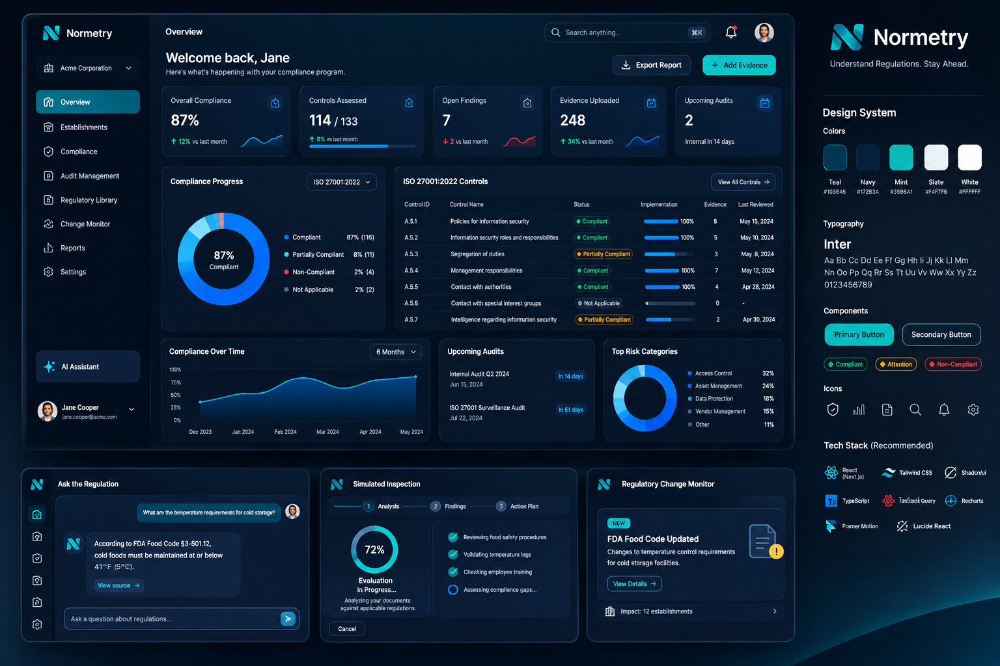
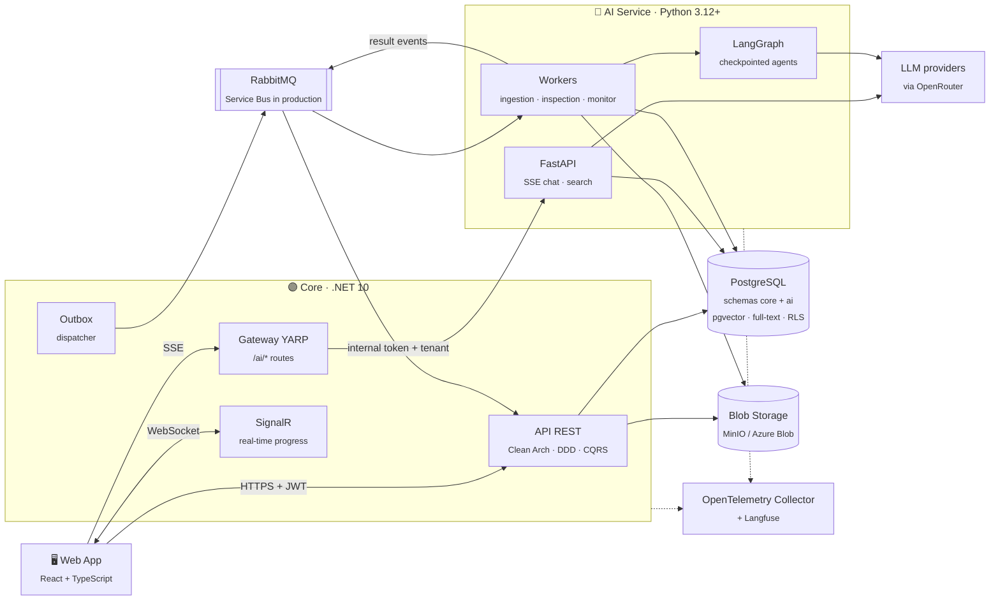
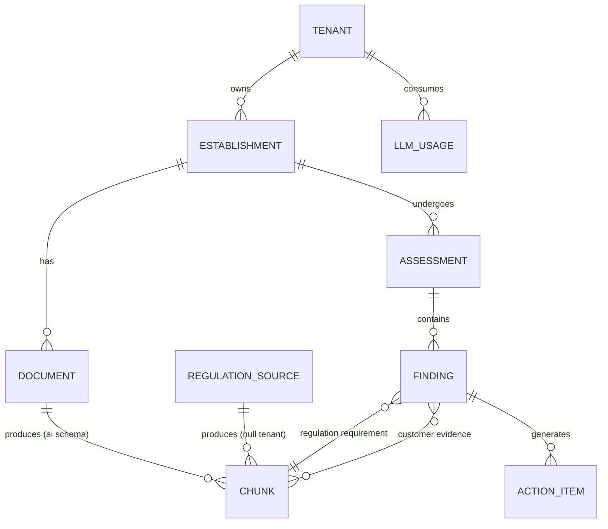
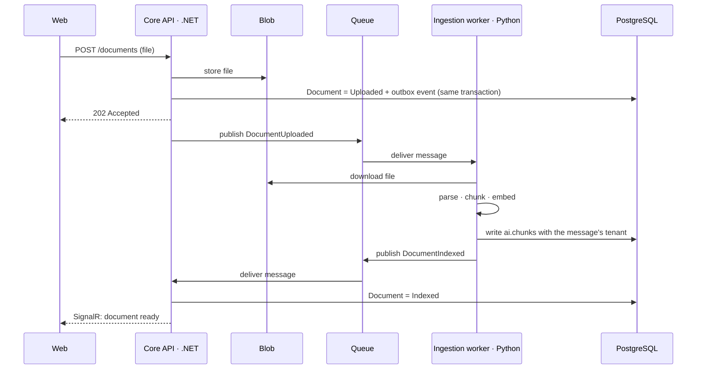
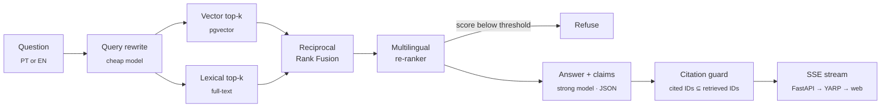
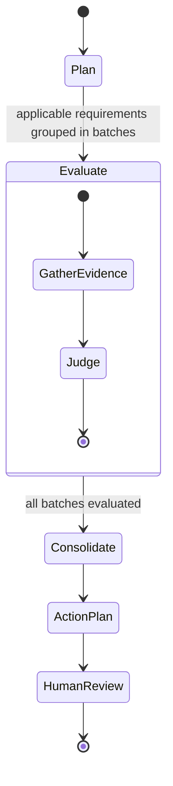

<!-- TODO(fill later): replace the text title with the logo once docs/design/logo.svg exists -->
<h1 align="center">Normetry</h1>

<p align="center">
  <i>Multi-tenant compliance copilot for regulated establishments.<br/>
  Ask the regulation and get an answer that cites the article, run a simulated inspection
  against your own documents, and get warned when a rule you depend on changes.</i>
</p>

<p align="center">
  
  <!-- TODO(fill later): CI badge once .github/workflows/ci.yml exists
  <a href="https://github.com/KauaVilasBoas/Normetry/actions/workflows/ci.yml">
    
  </a>
  -->
  <!-- TODO(fill later): latest release badge after v0.1.0 ships -->
  <!-- TODO(fill later): evals badge (retrieval recall@k / citation precision) once the eval suite runs in CI -->
  
  
  
  
  <a href="https://www.conventionalcommits.org/">
    
  </a>
  <a href="https://semver.org/">
    
  </a>
  <a href="LICENSE">
    
  </a>
</p>

<p align="center">
  <b>3</b> jurisdictions &nbsp;·&nbsp; <b>2</b> languages (PT, EN) &nbsp;·&nbsp; <b>3</b> AI capabilities
</p>

<p align="center">
  <a href="#what-is-this">Why</a> &nbsp;·&nbsp;
  <a href="#capabilities">Capabilities</a> &nbsp;·&nbsp;
  <a href="#architecture-at-a-glance">Architecture</a> &nbsp;·&nbsp;
  <a href="#engineering-decisions">Decisions</a> &nbsp;·&nbsp;
  <a href="#evals">Evals</a> &nbsp;·&nbsp;
  <a href="#getting-started">Run it</a> &nbsp;·&nbsp;
  <a href="#roadmap">Roadmap</a> &nbsp;·&nbsp;
  <a href="#engineering-workflow">Workflow</a>
</p>

> [!NOTE]
> Normetry is being built in public, one phase at a time (see the [Roadmap](#roadmap)). This README describes the target architecture. Sections marked "coming soon" fill in as each phase ships.

## What is this?

A restaurant manager has to comply with a food-safety code that runs to hundreds of pages. In practice, compliance lives in a binder: SOPs nobody re-reads, temperature logs filled in by hand, licenses that expire without warning. When an inspector arrives, someone has to say which rule each document satisfies and where the evidence is, and nobody can do that quickly.

Normetry answers that question. A customer (a single restaurant, a chain, or a compliance consultancy) registers its establishments and uploads its documents: SOPs, licenses, temperature logs, lab reports. Normetry reads them against the regulation, and every claim it makes points to a specific article and to a specific passage of the customer's own document.

The MVP covers food service in three jurisdictions:

| Jurisdiction | Regulation |
|---|---|
| United States | FDA Food Code |
| European Union | Regulation (EC) No 852/2004 on the hygiene of foodstuffs |
| Brazil | Anvisa RDC 216/2004, good practices for food services |

Users can ask in Portuguese or English, and answers quote the regulation in its original language. A question asked in Portuguese can come back with a cited passage of the FDA Food Code in English.

The data model already supports other establishment types such as pharmacies and clinics, so adding a vertical means adding its corpus and its eval set.

### Highlights

- Every claim cites a retrieved chunk. The model answers in structured JSON, and each claim carries the IDs of the chunks that support it. A deterministic guard drops any claim whose cited ID was not retrieved; if too little survives, the answer becomes "not enough basis in the regulation". When the re-ranker's best score falls below a threshold, the system declines to answer.
- Retrieval is written by hand: pgvector top-k and PostgreSQL full-text top-k, fused with Reciprocal Rank Fusion, then a multilingual re-ranker. Each step can be inspected and measured on its own.
- PostgreSQL Row-Level Security isolates tenants on every tenant-owned table, so even a buggy query cannot return another tenant's rows. The tenant is set per transaction, which keeps pooled connections from carrying it into the next request. A session with no tenant set sees only the public corpus and cannot write.
- Only a dedicated `corpus_ingestor` role can write the public regulation corpus (`tenant_id IS NULL`), so no tenant can inject text into the shared regulations.
- The simulated inspection is a LangGraph agent with Postgres checkpoints. If a worker dies mid-inspection, the run resumes where it stopped. Findings stay pending until a person accepts, rejects or edits them, and each rejection becomes a new eval example.
- Every pull request that touches prompts, retrieval or agents runs a reduced eval suite. The PR fails if a metric drops below its threshold, and the results table is posted as a PR comment.
- OpenTelemetry runs in both services and propagates W3C `traceparent` over HTTP and through the message queue, so a single trace follows a request from the click to the LLM call. Langfuse records prompts, tokens and cost.

## Capabilities

| Capability | What it does | Core technique |
|---|---|---|
| Ask the regulation | Answers regulatory questions in a chat and cites the exact article | Hybrid RAG with verifiable citations |
| Simulated inspection | Checks the establishment's documents against the applicable requirements and produces findings and an action plan | LangGraph agent with checkpoints and human review |
| Change monitor | Detects when a regulation changes and warns the tenants whose documents are affected | Structural diff plus semantic search over tenant documents |

<!-- TODO(fill later): screenshots / GIF of the three capabilities
## Screenshots


| Simulated inspection | Change monitor |
|---|---|
|  |  |

<sub>Captured from the public demo with fictional establishments and no real customer data.</sub>
-->

<!-- TODO(fill later): live demo link + demo video (in English)
**Live demo:** https://...  ·  **Demo video:** https://...
-->

### Design

The web app follows an approved mock: dark navy surfaces, one mint accent for actions, the Inter typeface, and a single card style for KPIs, tables, chat and inspection progress. [`docs/design/DESIGN.md`](docs/design/DESIGN.md) turns the mock into color tokens, component specs and a screen-by-screen mapping. The mock's sample content (ISO 27001 controls, a fictional company) is placeholder.



## Architecture at a glance

The system has two services with a hard ownership boundary: .NET owns the business logic and Python owns the AI. The .NET core is the only entry point from outside, and the Python service has no public ingress.



Only .NET writes the `core` schema and only Python writes the `ai` schema. AI results such as findings and document status reach the core as queue events.

### Bounded contexts (core)

| Context | Responsibility |
|---|---|
| Tenancy & Identity | Tenant, User and roles (Owner, Manager, Auditor). OIDC through Keycloak in local development |
| Establishments | Establishment with its type (restaurant, pharmacy, clinic) and jurisdiction |
| Documents | Document, versions, type (SOP, license, log, report), expiry and status `Uploaded → Processing → Indexed \| Failed` |
| Regulations | Regulation catalog (code, jurisdiction, version, effective date). Read-only in the core, because the AI service owns ingestion |
| Assessments | Simulated inspections, findings, action items and their review (Accepted, Rejected, Edited) |
| Usage & Budget | Tokens and cost per tenant and per feature, with limits |
| Notifications | Change-monitor alerts and expiring-document warnings |

<details>
<summary>Data model</summary>



Regulations and tenant documents share the central table, `ai.chunks`. A null `tenant_id` marks the public corpus, and RLS policies protect the rest.

```sql
-- read: public corpus + the caller's own tenant
CREATE POLICY chunks_read ON ai.chunks FOR SELECT
  USING (tenant_id IS NULL
         OR tenant_id = NULLIF(current_setting('app.tenant_id', true), '')::uuid);

-- public corpus: only the regulation-ingestion role can write it
CREATE POLICY chunks_corpus_write ON ai.chunks FOR ALL TO corpus_ingestor
  USING (tenant_id IS NULL) WITH CHECK (tenant_id IS NULL);
```

</details>

<details>
<summary>Document ingestion flow</summary>

Long-running work is asynchronous. The outbox keeps an event from being lost between the database commit and the queue.



1. Parse: Docling reads PDF and DOCX and keeps headings and tables. Scans and photos go through OCR or a multimodal LLM.
2. Structural chunking: regulations are split by article or section, and the hierarchy is kept in `section_path` (for example `Chapter 3 > 3-501.16`). Tables such as temperature logs become structured text plus metadata (dates, out-of-range values).
3. Enrichment: language, document type and expiry date are extracted with structured output.
4. Indexing: each chunk gets an embedding and a `tsvector` built with its language's configuration (`portuguese` or `english`).
5. Idempotency: a content hash identifies each chunk, and a new document version replaces the previous chunks in the same transaction.

</details>

<details>
<summary>Retrieval and generation (chat)</summary>



- Tenant, establishment and jurisdiction reach the AI service in internal headers that the .NET core derives from the validated JWT. The request body never sets them.
- A cheap model rewrites queries and classifies them. A strong model writes the final answer and makes the inspection judgments.

</details>

<details>
<summary>Simulated inspection agent</summary>



- Plan: regulation metadata (establishment type and jurisdiction) selects the applicable requirements, with no LLM involved. The requirements are grouped by theme: personal hygiene, temperature control, pests, water, waste.
- Evaluate: each batch runs in parallel through LangGraph's `Send`. For every requirement the agent gathers evidence from the establishment's documents, and an LLM judge classifies it as compliant, non-compliant or insufficient evidence. Each verdict cites both the regulation article and the customer's passage, with a confidence level.
- Consolidate: duplicates are removed and findings are sorted by severity.
- Action plan: each finding gets one concrete action with a suggested deadline.
- Human review: findings start as pending, and rejections feed the eval dataset.
- Resilience and budget: Postgres checkpoints (`langgraph-checkpoint-postgres`) let a run resume, and each inspection has a token ceiling charged to the tenant's budget.

</details>

<details>
<summary>Change monitor</summary>

- A scheduled job compares each new version of a regulation with the previous one, article by article, using `section_path` and a content hash.
- The changed articles are searched semantically across the documents of tenants in the same jurisdiction.
- Each affected tenant gets a notification that shows what changed and which passage of its SOP the change touches.
- The demo ingests a v1 and a v2 with controlled changes so the result is reproducible.

</details>

## Engineering decisions

Each row will get a full record in [`docs/adr/`](docs/adr/).
<!-- TODO(fill later): link each ADR number to its file once docs/adr/ is written -->

| ADR | Decision | Why | Trade-off |
|---|---|---|---|
| 001 | Core in .NET, AI in Python | .NET fits B2B domain modeling well; the RAG and eval ecosystem is more mature in Python | Two runtimes to maintain |
| 002 | One PostgreSQL with a `core` schema (EF Core) and an `ai` schema (Alembic) | pgvector and full-text search live next to the business data, with no external vector DB to sync | At millions of chunks, Qdrant or Azure AI Search may be needed |
| 003 | Tenant isolation with Row-Level Security | A query bug still cannot return another tenant's rows | The tenant must be set per transaction to stay safe with connection pooling |
| 004 | .NET as the single entry point, with YARP in front of Python | Auth, rate limiting and the token budget live in one place, and Python is never exposed | One extra network hop on chat |
| 005 | Outbox for long-running work, SSE for chat | Ingestion and inspection can take minutes, and the outbox keeps every event | The UI is eventually consistent; SignalR pushes the updates |
| 006 | Retrieval written by hand, LangGraph only for agents | Full control over each step, and every step can be explained | More code to own |
| 007 | Verifiable citations | Structured output plus a check that every cited passage was retrieved | One extra validation step |
| 008 | Embedding model behind an interface, chosen by eval | Changing models becomes an experiment with a measured result | None so far |

<details>
<summary>Why PostgreSQL and not SQL Server?</summary>

SQL Server 2025 has a vector type and would work. PostgreSQL has the larger ecosystem for this workload: pgvector is the default in Python AI tooling, HNSW indexes and full-text search run in the same engine, and Azure offers it as a managed service (Flexible Server).

</details>

## Security

- Indirect prompt injection: document content enters prompts delimited as data, agents have no write tools, and every state change goes through a person. The eval suite includes planted malicious documents.
- Tenant isolation: RLS, integration tests for cross-tenant leaks and adversarial evals ("show me the other customer's SOP"). The target is zero leaks.
- Network edge: the Python service has no public ingress, and FastAPI accepts only requests that YARP sends with an internal token.
- Abuse and cost: ASP.NET Core rate limiting and a per-tenant token budget.
- Uploads: file type and size are validated.
- Personal data: employee names found in documents are masked in logs and LLM traces.
- Secrets: none are stored in this repository. Local development uses git-ignored `.env` files and `dotnet user-secrets`, and CI and deploy read GitHub Actions secrets.

## Evals

Five layers of evals measure quality:

| Layer | Metric | How it's measured |
|---|---|---|
| Retrieval | recall@k, MRR | 80 to 100 questions with annotated expected chunks |
| Generation | faithfulness, citation precision, relevance | LLM-as-judge (DeepEval or Ragas) plus a deterministic check of cited IDs |
| Inspection | finding precision and recall | 3 to 5 synthetic establishments with planted non-conformities |
| Security | cross-tenant leaks, successful injections | Adversarial prompts and malicious documents |
| Operations | cost per question and per inspection, p95 latency | Langfuse and OpenTelemetry |

The LLM-as-judge is checked against about 30 hand-labeled examples before it is trusted, and its agreement rate is reported. Planned experiments compare vector-only and hybrid retrieval, retrieval with and without the re-ranker, and local BGE-M3 against hosted embeddings.

<!-- TODO(fill later): experiment results table (one row per experiment, with the measured numbers) -->

## Stack

<p>
  
  
  
  
  
  
  
  
  
  
  
  
  
  
  
  
  
  
  
  
  
  
  
  
</p>

## Getting started

Coming soon: run instructions arrive with the phase 0 scaffold.

<!-- TODO(fill later): real prerequisites and commands once the monorepo is scaffolded
Prerequisites: .NET 10 SDK, Python 3.12+, Node 20+, Docker.

```bash
git clone https://github.com/KauaVilasBoas/Normetry.git
cd Normetry
cp .env.example .env              # fill in your own LLM provider key
dotnet run --project src/core/Normetry.AppHost   # Aspire boots everything
```

The Aspire dashboard shows every service, container and OpenTelemetry trace.
`docker compose -f deploy/docker-compose.yml up` is the alternative without Aspire.
-->

### Tests

<!-- TODO(fill later): test commands for both services -->
- Domain: unit tests.
- Integration: Testcontainers with a real PostgreSQL, RLS included. Tenant A must never read tenant B's chunks.
- Architecture: NetArchTest rules fail the build when a layer depends on one it should not.
- Evals: a reduced suite runs on every pull request that touches prompts, retrieval or agents.

## Project structure

```
normetry/
├── src/
│   ├── core/                      # .NET 10
│   │   ├── Normetry.BuildingBlocks/
│   │   ├── Normetry.Domain/
│   │   ├── Normetry.Application/
│   │   ├── Normetry.Infrastructure/
│   │   ├── Normetry.Api/
│   │   ├── Normetry.ServiceDefaults/  # Aspire: telemetry, health checks
│   │   ├── Normetry.AppHost/      # Aspire
│   │   └── tests/                 # unit, integration, architecture
│   ├── ai/                        # Python
│   │   ├── normetry_ai/
│   │   │   ├── api/               # FastAPI: chat and search
│   │   │   ├── ingestion/
│   │   │   ├── retrieval/
│   │   │   ├── agents/            # LangGraph
│   │   │   └── llm/               # providers, routing, cost
│   │   └── tests/
│   └── web/                       # React + TypeScript
├── evals/
│   ├── datasets/
│   ├── scenarios/                 # synthetic establishments
│   └── reports/
├── corpus/                        # versioned regulations + download scripts
├── docs/
│   ├── adr/
│   ├── design/                    # approved UI mock + design system
│   └── architecture.md
├── deploy/
│   ├── docker-compose.yml
│   └── terraform/
└── .github/workflows/
```

## Roadmap

| Phase | Delivery | Status |
|---|---|---|
| 0 · Foundation | Monorepo, Aspire, auth, tenants and establishments, PostgreSQL with RLS and isolation tests, CI | In progress |
| 1 · Regulation RAG | Ingestion of the 3 regulations, hybrid search with re-ranker, cited chat, retrieval and generation evals in CI | Planned |
| 2 · Simulated inspection | Async upload and ingestion, LangGraph agent, human review, planted scenarios | Planned |
| 3 · Polish | Change monitor, MCP server, Langfuse, Azure deploy, demo video | Planned |

Phase 3 also adds an MCP server: the .NET core exposes read-only tools (establishments, expiring documents, latest findings) through the official C# MCP SDK, so Claude Desktop can connect straight to the product. A second retrieval adapter, Azure AI Search behind the same interface, will be compared against pgvector by the evals.

The MVP leaves out billing, corporate SSO and a mobile app.

<!-- TODO(fill later): "What I learned" + "What I'd do differently" sections after phase 1 ships -->

## Engineering workflow

- Each feature starts as a GitHub issue, gets its own branch and lands through a pull request that closes the issue. Merged branches are deleted.
- Commits follow [Conventional Commits](https://www.conventionalcommits.org/), one logical change per commit.
- Versions follow [SemVer](https://semver.org/). [release-please](https://github.com/googleapis/release-please) reads the commit history and keeps a release PR open; merging it creates the tag, the GitHub Release and the `CHANGELOG.md` entry. The project stays on 0.x until the MVP is published.
- Architecture decisions are recorded as ADRs in [`docs/adr/`](docs/adr/).
- Development uses Claude Code with a harness committed in this repository: [`CLAUDE.md`](CLAUDE.md) files per service, specialist subagents (.NET core, AI service, web, UX/UI review, tenant-isolation review, eval runner), project skills for RLS tables, CQRS slices, ADRs and the design system, and hooks that block secret-looking content, secret-file reads and destructive commands.

## Author

Kauã Vilas Boas, backend engineer working in .NET and C#. I build .NET systems and libraries with documented architecture and CI/CD.

<p>
  <a href="https://www.linkedin.com/in/kauavilasboas/">
    
  </a>
  <a href="https://github.com/KauaVilasBoas">
    
  </a>
  <a href="mailto:kauavboas@gmail.com">
    
  </a>
</p>

Based in Brazil (UTC−3), with full overlap with US East Coast hours and European afternoons. Open to remote opportunities.

## License

[MIT](LICENSE)
