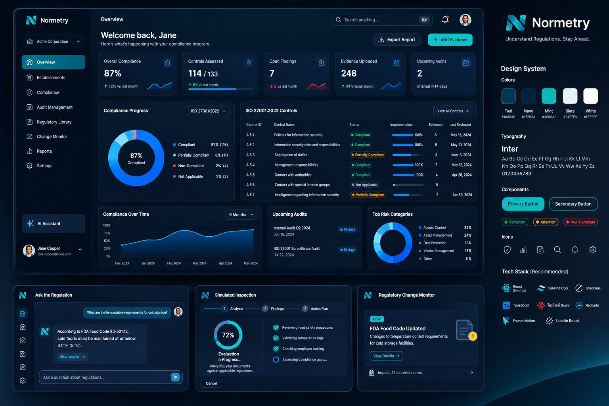

# Normetry Design System



`reference.png` is the approved mock and the source of truth for look and feel. This file turns it into exact values and rules. When they disagree, the image wins on appearance and this file wins on numbers — then fix this file.

> **Content in the mock is placeholder.** ISO 27001 controls, "Acme Corporation", "Jane Cooper" and the dates only illustrate layout. Normetry's real domain is food-safety regulation (FDA Food Code, EU Regulation 852/2004, Anvisa RDC 216/2004): keep the layout and style, swap the content.

## 1. Brand

- **Logo:** geometric "N" mark with a mint → teal gradient, followed by the wordmark "Normetry" in white Inter semibold. Mark alone is used in compact places (chat avatar, panel headers, icon rail).
- **Tagline:** "Understand Regulations. Stay Ahead."
- **Mood:** dark, calm, precise. Deep navy surfaces, **one** mint accent for action, blues for data, status colors only for status.
<!-- TODO(fill later): export the logo as SVG to docs/design/logo.svg; today it exists only inside reference.png -->

## 2. Color tokens

Values sampled from the rendered mock. The mock's palette card labels slightly different hexes (Teal `#103846`, Navy `#172B3A`, Mint `#35B6A1`, Slate `#F4F7FB`); the UI itself is drawn with the values below, so these are canonical.

### Surfaces

| Token | Hex | Use |
|---|---|---|
| `--bg-canvas` | `#010A18` | page background, behind the app frame (subtle radial glow `#001427` toward the bottom right) |
| `--bg-sidebar` | `#010D1B` | sidebar and icon rail |
| `--bg-app` | `#04192E` | main content area |
| `--bg-card` | `#06182E` | cards |
| `--bg-inset` | `#041425` | table body, inner panels, inputs |
| `--bg-elevated` | `#0C203B` | AI Assistant card, assistant chat bubble, dropdowns, popovers |
| `--border` | `#0E233C` | 1px borders of cards, inputs, dividers |

### Brand and text

| Token | Hex | Use |
|---|---|---|
| `--mint` | `#0DC6CE` | primary button, send button, radial progress, links ("View source →"), focus ring, active step |
| `--mint-hover` | `#09B9B8` | hover / pressed of mint elements |
| `--on-mint` | `#06283A` | text and icons on mint (dark, never white) |
| `--teal` | `#005E7A` | active sidebar item background |
| `--teal-border` | `#2E7D99` | secondary button and outlined action borders |
| `--teal-deep` | `#064C5E` | "NEW" badge background (mint text) |
| `--text-primary` | `#FFFFFF` | titles, KPI values, table primary text |
| `--text-secondary` | `#A9B8CC` | subtitles, card labels, legend labels |
| `--text-muted` | `#6B7F99` | table headers, axis labels, captions, timestamps |

### Status (only for compliance state and deltas)

| Token | Hex | Use |
|---|---|---|
| `--success` | `#03DA96` | Compliant, positive delta (↑) |
| `--warning` | `#F2AE13` | Partially Compliant, Attention |
| `--danger` | `#ED3F45` | Non-Compliant, negative delta (↓) |
| `--neutral` | `#5B6B82` | Not Applicable, empty states |
| `--alert` | `#F4C33A` | "!" badge on change-monitor documents |
| `--info` / `--info-bg` | `#0DECFF` / `#06315E` | time badges such as "In 14 days" |

### Data visualization

| Token | Hex | Use |
|---|---|---|
| `--chart-1` | `#0084ED` | progress bars, area-chart line |
| `--chart-2` | `#23B6FD` | donut main segment, sparklines |
| `--chart-area` | `#0084ED` → `#012649` | area fill: vertical gradient to transparent |
| `--chart-danger` | `#ED3F45` | non-compliant segment, negative sparkline |
| `--chart-neutral` | `#5B6B82` | N/A segment, progress track uses `#0C1E36` |

```css
:root {
  --bg-canvas: #010a18; --bg-sidebar: #010d1b; --bg-app: #04192e; --bg-card: #06182e;
  --bg-inset: #041425; --bg-elevated: #0c203b; --border: #0e233c;
  --mint: #0dc6ce; --mint-hover: #09b9b8; --on-mint: #06283a;
  --teal: #005e7a; --teal-border: #2e7d99; --teal-deep: #064c5e;
  --text-primary: #ffffff; --text-secondary: #a9b8cc; --text-muted: #6b7f99;
  --success: #03da96; --warning: #f2ae13; --danger: #ed3f45; --neutral: #5b6b82;
  --alert: #f4c33a; --info: #0decff; --info-bg: #06315e;
  --chart-1: #0084ed; --chart-2: #23b6fd; --chart-track: #0c1e36;
  --radius-card: 12px; --radius-control: 10px; --radius-pill: 9999px;
}
```

shadcn/ui mapping: `--background` = `--bg-app`, `--card` = `--bg-card`, `--popover` = `--bg-elevated`, `--primary` = `--mint`, `--primary-foreground` = `--on-mint`, `--border` / `--input` = `--border`, `--ring` = `--mint`, `--muted-foreground` = `--text-muted`, `--destructive` = `--danger`. Dark theme only for now.

## 3. Typography

- **Font:** Inter, everywhere. Tabular numbers (`font-variant-numeric: tabular-nums`) for KPIs, tables and percentages.
- **Scale:**

| Role | Size / weight | Example |
|---|---|---|
| Page greeting | 22px / 600 | "Welcome back, Jane" |
| Top bar page title | 15px / 600 | "Overview" |
| KPI value | 26–28px / 700 | "87%", "114 / 133" (the "/ 133" part is 20px / 500) |
| Card title | 14–15px / 600 | "Compliance Progress" |
| Body / nav / table | 12–13px / 400–500 | nav items, table rows |
| Caption / delta / axis | 11px / 400–500 | "12% vs last month" |

## 4. Layout

- **App frame:** sidebar 220px fixed + content. Content padding 20px; gap between cards 16px.
- **Sidebar (top → bottom):** logo · organization switcher (building icon, name, chevron, bordered) · navigation · flexible space · AI Assistant card (sparkle icon, `--bg-elevated`) · user card (avatar, name, email, chevron).
- **Navigation:** icon (outline, 18px) + label. Active item = `--teal` filled, rounded 10px, white text. Items: Overview, Establishments, Compliance, Audit Management, Regulatory Library, Change Monitor, Reports, Settings.
- **Top bar:** page title left; search field ("Search anything…", ⌘K hint) · notification bell · avatar right.
- **Page header:** greeting + one-line subtitle on the left; secondary action ("Export Report", icon + text) then primary action ("+ Add Evidence") on the right.
- **Overview grid:**
  1. KPI row — 5 equal cards.
  2. Donut card (≈ 1/3) + controls table card (≈ 2/3).
  3. Area chart (≈ 2/5) + upcoming list (≈ 1/4) + risk donut (≈ 1/3).
- **Feature panels** (Ask the Regulation, Simulated Inspection, Change Monitor) use the same card language; Ask the Regulation keeps a narrow icon rail on its left.

## 5. Components

| Component | Spec |
|---|---|
| **Card** | `--bg-card`, 1px `--border`, radius 12px, padding 16–20px. Title top-left (14–15px/600); optional control top-right (dropdown or outlined "View all →" button). No heavy shadows. |
| **KPI card** | label (secondary) + icon in a 28px rounded-square tile top-right (mint/blue outline icon) · value · delta row (↑ `--success` / ↓ `--danger` + "vs last month" muted) · sparkline bottom-right **or** a progress bar. |
| **Primary button** | `--mint` fill, `--on-mint` text 13px/600, radius 10px, height 36px, optional leading icon (+). One per view. |
| **Secondary button** | transparent, 1px `--teal-border`, white text, radius 10px, optional leading icon. |
| **Status pill** | fully rounded, 1px border in the status color, background = status color at ~10% opacity, text in the status color 11–12px/500, leading glyph: ◆ diamond for Compliant and Attention/Partially Compliant, ● dot for Non-Compliant, ⊘ for Not Applicable. |
| **Time badge** | `--info-bg` fill, `--info` text, radius 6px, 11px ("In 14 days"). |
| **"NEW" badge** | `--teal-deep` fill, mint text, uppercase 10px/700, radius 4px. |
| **Dropdown / select** | `--bg-inset`, 1px `--border`, radius 8px, chevron right ("ISO 27001:2022 ⌄", "6 Months ⌄"). |
| **Table** | header row in `--text-muted` 11px; rows 12px with 1px `--border` separators, no zebra; columns: ID · name · status pill · progress bar + % · count · date. |
| **Progress bar** | 6px high, `--chart-track` track, `--chart-1` fill, rounded; percentage to the right in white. |
| **Donut** | thick ring (~18% of radius), big centered value + caption; legend to the right: color dot · label · % · (count). |
| **Area chart** | single series, `--chart-1` line 2px with dot markers, gradient fill, muted 0–100% axis, month labels. |
| **Radial progress** | mint ring on `--chart-track`, centered % (white, 20px/700) + status text ("Evaluation In Progress…"). |
| **Stepper** | numbered circles connected by a line: "1 Analysis — 2 Findings — 3 Action Plan"; current step mint, others muted. |
| **Checklist** | mint filled check-circle for done, mint outlined circle for in progress, muted text. |
| **Chat** | user bubble right-aligned (`--chart-1`/blue tint fill, white text) with avatar; assistant bubble left with the N mark, `--bg-elevated`; citation action as an outlined mint chip "View source →"; input = rounded field on `--bg-inset` with a round mint send button. |
| **Change alert card** | "NEW" badge, title (white 16px/600), description (secondary), outlined "View Details →", document illustration with an `--alert` "!" badge; footer row with icon + "Impact: N establishments" + chevron. |
| **Icons** | Lucide, outline, 1.5px stroke, 16–20px, `--text-secondary` by default, mint when active. |

## 6. Motion

Subtle and functional (Framer Motion): cards fade/slide in 150–200ms on load, chart lines draw once, streaming chat text appears token by token, radial progress animates between values. No bouncing, no parallax.

## 7. Implementation stack (recommended by the reference)

React + TypeScript · Tailwind CSS · shadcn/ui · TanStack Query · Recharts · Framer Motion · Lucide React. The reference names Next.js; whether the web app is Next.js or a Vite SPA in front of the .NET API is decided by an ADR when `src/web` is scaffolded.

## 8. Normetry screen inventory

| Screen | Built from |
|---|---|
| Overview | KPI row, compliance donut, controls/requirements table, compliance over time, upcoming audits, top risk categories |
| Ask the Regulation | chat with citations ("View source →" opens the article in its original language) |
| Documents | upload + table with type, expiry and ingestion status pills |
| Simulated Inspection | stepper + radial progress + checklist while running; findings table with status pills and Accept / Reject / Edit after |
| Change Monitor | change alert cards with impact footer |
| Establishments, Reports, Settings | same card + table language |
