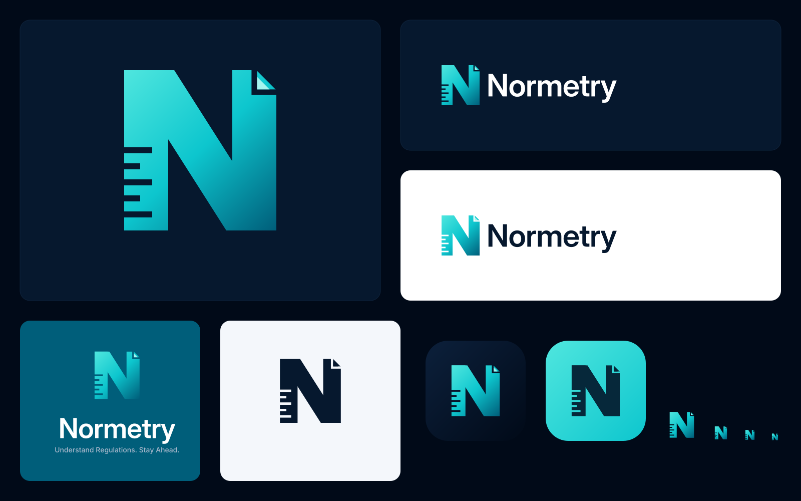

# Normetry brand

The logo is an "N" built like a page. The left stem has text lines cut into it, and the top-right corner folds like a sheet of paper. Regulations and the establishment's own documents are what Normetry reads, so the mark is a document that is also the letter N.

## Files

| File | Use |
|---|---|
| `logo-horizontal-dark.svg` | primary logo, on dark surfaces (the app, auth screens, slides) |
| `logo-horizontal-light.svg` | on white or light surfaces |
| `logo-horizontal-mono-white.svg` | one color, on photos or a teal background |
| `logo-horizontal-mono-navy.svg` | one color, print and light backgrounds |
| `logo-horizontal-on-mint.svg` | on a mint background (`--on-mint`) |
| `logo-stacked-dark.svg`, `logo-stacked-light.svg` | stacked with the tagline, for square spaces (cover slides, social profile) |
| `mark.svg` | the symbol alone, where its box is over 40px |
| `mark-compact.svg` | the symbol where its box is 40px or less (the app's sidebar, sign-in screen and chat avatar, the favicon): three thicker lines instead of five |
| `mark-mono-white.svg`, `mark-mono-navy.svg` | the symbol in one color |
| `favicon.svg` | browser tab (same drawing as `mark-compact.svg`) |
| `app-icon.svg`, `app-icon-mint.svg` | app and PWA icon: navy (default) or mint |
| `png/` | raster exports: app icon 1024/512/192, Apple touch icon 180, favicon 32/16, logos |
| `alternatives/` | the other explored symbols: lines only, book pages, pages with the fold |

The wordmark is Inter Display SemiBold with −1.2% tracking, converted to outlines, so the SVG files do not need the font. In the SPA (`src/web/src/ui/Logo.tsx`) and the Keycloak login the wordmark is live Inter text, which they already load. They load Inter without its optical-size axis, so the live text is Inter SemiBold, about 6% wider than the outlined Inter Display.

## Construction

- 100-unit grid. The mark spans x 12–88 and y 10–90.
- Stems are 22u wide. The diagonal is 25u wide horizontally, which gives about 21u of real thickness, so it carries the same weight as the stems.
- The N is point-symmetric: rotated 180° around (50, 50) it lands on itself.
- Text lines: 3u tall, every 8u from y = 50 to 82, alternating 14u and 8u long. The compact mark keeps the three long lines at 4.8u.
- Fold: 11u. A gap of 1.4u (2.2u in the compact mark) separates the flap from the page, so the fold survives in one color.

## Colors

| Name | Hex | Where |
|---|---|---|
| Mint light | `#4FE6DE` | gradient start (top left) · token `--logo-mint-light` |
| Mint | `#0DC6CE` | gradient middle · token `--mint` |
| Teal | `#005E7A` | gradient end (bottom right) · token `--teal` |
| Fold | `#A6F5EF` | the folded corner · token `--logo-fold` |
| Navy | `#06182E` | wordmark and mono version on light backgrounds |

Mint light and Fold exist only in the logo. They are never used for UI.

## Rules

- Clear space: at least 30% of the symbol's height on every side.
- Minimum size: horizontal logo 24px tall; symbol 16px (the compact mark wherever its box is 40px or less).
- Do not stretch, rotate, recolor the gradient, add shadows or outlines, or set the wordmark in another font.
- On busy images use a mono version.
